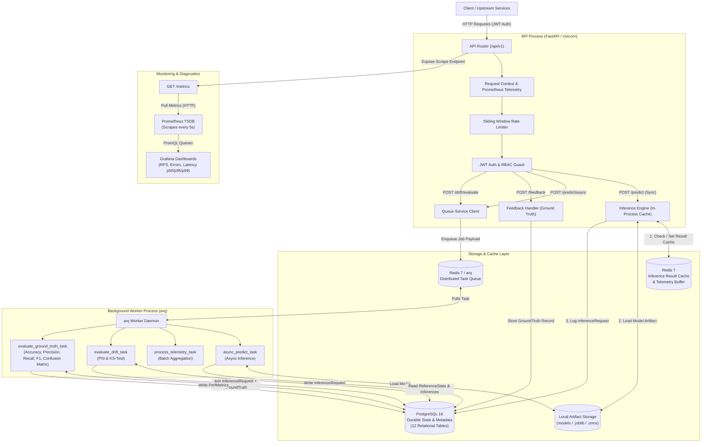
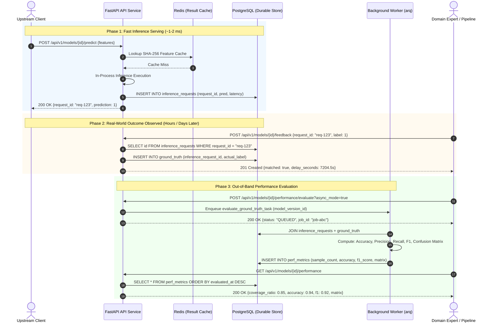

# ModelOps Sentinel

> **Backend Platform for Machine Learning Model Lifecycle Management, Serving and Monitoring**

[](https://www.python.org/)
[](https://fastapi.tiangolo.com/)
[](https://www.postgresql.org/)
[](https://redis.io/)
[](https://www.sqlalchemy.org/)
[](https://alembic.sqlalchemy.org/)
[](https://prometheus.io/)
[](https://grafana.com/)
[](https://www.docker.com/)
[](https://docs.pytest.org/)
[](https://github.com/astral-sh/ruff)

ModelOps Sentinel is an engineering-first backend platform designed to govern the full machine learning model lifecycle: from artifact registration and semantic versioning to low-latency cached inference, background asynchronous processing, out-of-band statistical data drift detection, and closed-loop delayed ground-truth performance evaluation.

Built as an **asynchronous modular monolith**, ModelOps Sentinel demonstrates clean backend systems architecture: strict separation of durable relational state from ephemeral time-series telemetry, fail-open caching with circuit breakers, background task distribution via Redis/arq, and cryptographic auditability across all model operations.

---

## Engineering Highlights

- **RESTful API Development**: Asynchronous, strongly typed RESTful API designed with FastAPI, Pydantic v2 schemas, and dependency injection.
- **Asynchronous Task Processing**: Decoupled background task execution using Redis and `arq` with task timeouts, retry backoff policies, and an in-memory queue fallback for zero-dependency execution.
- **Relational Database Design**: 12 normalized PostgreSQL tables managed via async SQLAlchemy 2.0, connection pooling via `asyncpg`, and schema migrations with Alembic.
- **Authentication & RBAC**: Stateless JWT Bearer token authentication, bcrypt password hashing (cost factor 12), and granular Role-Based Access Control (`admin`, `engineer`, `viewer`, `operator`).
- **Caching, Rate Limiting & Circuit Breaking**: Multi-tier caching with deterministic SHA-256 feature hashing, Redis sliding-window rate limiting, and fail-open circuit-breaker patterns.
- **Automated Testing & Quality Assurance**: 86 automated unit, integration, and worker tests using Pytest, pytest-asyncio, aiosqlite, and HTTPX.
- **Observability & Telemetry**: Native Prometheus metrics exposition (`/metrics`) with route cardinality normalization, HTTP/inference latency percentiles ($p50$, $p95$, $p99$), and pre-provisioned Grafana dashboards.
- **Statistical Monitoring & Delayed Ground-Truth Evaluation**: Real-time feature drift detection (Population Stability Index with Laplace smoothing, Two-Sample Kolmogorov-Smirnov test) and closed-loop ground-truth outcome matching by `request_id`.

---

## Table of Contents

- [Engineering Highlights](#engineering-highlights)
- [Overview](#overview)
- [Key Features](#key-features)
- [System Architecture](#system-architecture)
  - [Two-Process Concurrency Model](#two-process-concurrency-model)
  - [Component Responsibilities](#component-responsibilities)
  - [End-to-End Data Flow](#end-to-end-data-flow)
- [Technology Stack](#technology-stack)
- [Project Structure](#project-structure)
- [Installation and Local Setup](#installation-and-local-setup)
  - [Prerequisites](#prerequisites)
  - [Zero-Docker Setup (Local SQLite Mode)](#zero-docker-setup-local-sqlite-mode)
  - [Docker Compose Setup](#docker-compose-setup)
- [Environment Variables](#environment-variables)
- [API Documentation](#api-documentation)
  - [Authentication & RBAC](#authentication--rbac)
  - [Health & Diagnostics](#health--diagnostics)
  - [Model Registry & Versions](#model-registry--versions)
  - [Inference Service (Sync & Async)](#inference-service-sync--async)
  - [Asynchronous Job Management](#asynchronous-job-management)
  - [Statistical Data Drift Monitoring](#statistical-data-drift-monitoring)
  - [Delayed Ground-Truth Feedback & Evaluation](#delayed-ground-truth-feedback--evaluation)
  - [Telemetry & Prometheus Metrics](#telemetry--prometheus-metrics)
- [Delayed Ground-Truth Evaluation](#delayed-ground-truth-evaluation)
  - [The Core Operational Challenge](#the-core-operational-challenge)
  - [Delayed Feedback Workflow](#delayed-feedback-workflow)
  - [Classification Metrics Computed](#classification-metrics-computed)
  - [Strict Three-Way Metric Separation](#strict-three-way-metric-separation)
- [Testing and Quality Assurance](#testing-and-quality-assurance)
- [Current Implementation Status](#current-implementation-status)
- [Future Roadmap](#future-roadmap)
- [Engineering Decisions](#engineering-decisions)
- [Author](#author)

---

## Overview

In machine learning engineering, training a model is often the easiest step. The real challenge is **production operations**:
- **Silent Degradation**: Models silently decay in the wild due to covariate shift (input data drift) and concept drift (real-world relationship changes), frequently without triggering standard HTTP errors.
- **Latency & Compute Waste**: Heavy feature vectors repeatedly invoke expensive model matrix operations on identical inputs when low-latency cache-aside layers could eliminate compute bottlenecks.
- **The Ground-Truth Latency Gap**: Real-world labels (e.g., loan defaults, fraud chargebacks, medical diagnoses, industrial sensor confirmations) arrive hours, days, or months after inference. Platforms must link outcomes back to exact historical predictions without blocking real-time serving.
- **Auditability & Integrity**: Reliable operations require verifiable records of who uploaded weights, validated schemas, promoted versions, and handled traffic routing.
- **Microservice Overhead**: Small-to-medium enterprise ML systems frequently drown in microservice complexity (separate registry, inference, queuing, and monitoring services).

**ModelOps Sentinel solves these challenges with a lean, interview-defensible architecture:**
1. **Immutable Model Registry**: Artifacts are validated against strict input/output JSON schemas and hashed (SHA-256) on disk.
2. **Dual-Path Inference Serving**: Fast synchronous inference (~1–2 ms on local test runs) with in-process memory caching and Redis cache-aside alongside decoupled asynchronous batch execution via job queues.
3. **Out-of-Band Statistical Drift Monitoring**: Automated Population Stability Index (PSI) and Two-Sample Kolmogorov-Smirnov (KS) tests run periodically without degrading the prediction request path.
4. **Closed-Loop Delayed Evaluation**: Late-arriving ground-truth outcomes match back to prior predictions via immutable correlation IDs (`request_id`), computing accuracy, precision, recall, F1, and confusion matrices in the background.
5. **Strict Architectural Separation**: Offline validation benchmarks, online serving telemetry (Prometheus), and delayed ground-truth performance metrics are kept strictly separate to preserve auditability and prevent alert fatigue.

---

## Key Features

### 1. Model Registry & Artifact Management
- **Semantic Versioning**: Models belong to a logical parent entity (`Model`) and maintain immutable iterations (`ModelVersion`, e.g., `v1.0.0`) enforced by unique database constraints.
- **SHA-256 Checksum Verification**: Every uploaded binary (`.joblib` or `.onnx`) is hashed during ingestion and verified before loading to prevent supply-chain tampering.
- **Schema Enforcement**: Input features and expected outputs are validated against JSON schema definitions before serving.
- **Lifecycle State Machine**: Versions transition through formal statuses: `REGISTERED` -> `VALIDATING` -> `STAGING` -> `ACTIVE` -> `RETIRED` or `FAILED`.

### 2. Authentication & Role-Based Access Control (RBAC)
- **Stateless JWT Security**: Industry-standard cryptographic Bearer tokens (HMAC-SHA256) with configurable expiration (`ACCESS_TOKEN_EXPIRE_MINUTES`).
- **Bcrypt Password Hashing**: Passwords salted and hashed with a cost factor of 12.
- **Role Hierarchy**: Fine-grained authorization enforcing least privilege:
  - `admin`: Unrestricted administrative access across all endpoints.
  - `engineer`: Create models, upload versions, and trigger drift/performance evaluations.
  - `operator`: Trigger evaluations and submit feedback.
  - `viewer`: Read models, inspect drift reports, query performance, and submit inference requests.
- **Rate Limiting**: Sliding-window rate limiter protecting authentication routes against brute-force attacks with automatic in-memory fallback.
- **Audit Logging**: Immutable audit trail (`audit_logs`) recording user ID, action, entity type, and before/after payloads for compliance.

### 3. Dual-Mode Inference Serving Engine
- **Synchronous Prediction**: Fast REST inference via `POST /api/v1/models/{id}/predict` with in-process deserialized model caching and sub-millisecond Redis response caching.
- **Asynchronous Batch Prediction**: Non-blocking submission via `POST /api/v1/models/{id}/predict/async` returning `HTTP 202 Accepted` with a `job_id` for background queue execution.
- **Job Status Polling**: `GET /api/v1/jobs/{job_id}` returns lifecycle state (`queued`, `in_progress`, `complete`, `failed`), retry attempts, result payload, and error traces.

### 4. Resilient Multi-Tier Caching & Circuit Breaking
- **In-Process Model Cache**: Keeps active scikit-learn/joblib objects in worker memory to eliminate disk I/O on repeated inference calls.
- **Deterministic Feature Caching**: Computes SHA-256 digests over sorted input feature vectors, caching inference results in Redis with a 5-minute TTL.
- **Circuit Breaker Fail-Open**: If Redis becomes unreachable, the inference engine trips a circuit breaker and falls back to memory, ensuring predictions continue without downtime even during cache outages.

### 5. Asynchronous Background Task Architecture
- **Distributed Task Processing**: Powered by `arq` and Redis, separating heavy CPU work (model deserialization, NumPy operations, SciPy statistical tests) from the web event loop.
- **Zero-Docker In-Memory Fallback**: Includes an in-memory queue backend (`MemoryQueueBackend`) replicating `arq` semantics (timeouts, retries, exponential backoff) for instant local testing and CI/CD without Docker.
- **Task Retry Policy**: Bounded execution with automatic retry backoff (`max_tries=3`) and strict timeout protection.

### 6. Statistical Data Drift Monitoring
- **Baseline Profiling (`ReferenceStats`)**: Profiles training/validation feature distributions (decile quantiles, parametric moments, and sample reservoirs).
- **Population Stability Index (PSI)**: Industry-standard drift metric with adaptive quantile binning and Laplace pseudo-count smoothing to eliminate false positives on small sample sizes.
- **Kolmogorov-Smirnov (KS) Test**: Two-sample non-parametric continuous distribution test evaluating cumulative distribution divergence ($D$) and statistical significance ($p$-value).
- **Automated Drift Events**: Granular per-feature evaluations recorded in `drift_events` with score, threshold, and severity classification (`NONE`, `MEDIUM`, `HIGH`).

### 7. Delayed Ground-Truth Evaluation
- **Closed-Loop Outcome Ingestion**: Late-arriving real-world labels ingested via `POST /api/v1/models/{id}/feedback` and matched to historical predictions by `request_id`.
- **Duplicate & Cross-Model Guards**: Enforces strict model ownership and rejects duplicate feedback submissions with `409 Conflict`.
- **Classification Performance Metrics**: Computes true production accuracy, precision, recall, F1-score, and a structured confusion matrix (`tp`, `tn`, `fp`, `fn` for binary classification; weighted averaging for multiclass).
- **Label Coverage Tracking**: Quantifies the percentage of served inferences that have confirmed real-world feedback (`label_coverage_ratio`).

### 8. Observability & Operational Diagnostics
- **Prometheus Telemetry**: Native exposition at `GET /metrics` exporting request counters, HTTP error counters, latency histograms ($p50, p95, p99$), pure inference duration histograms, model usage counters, and cache hit/miss counters.
- **Cardinality Protection**: Dynamic URL path normalization (`normalize_endpoint`) replaces variable UUIDs and hash fragments with `{id}` to prevent Prometheus label cardinality explosion.
- **Grafana Dashboard**: Pre-provisioned operational dashboard (`deploy/grafana/dashboards/modelops_sentinel.json`) visualizing RPS, error percentage, latency percentiles, and cache hit ratios.
- **Liveness & Readiness Probes**: Kubernetes-ready `/api/v1/health` and `/api/v1/ready` endpoints verifying application health and downstream PostgreSQL/Redis availability.

---

## System Architecture

### Two-Process Concurrency Model

ModelOps Sentinel uses a single codebase packaged in a single Docker image built from a multi-stage `Dockerfile`. In deployment, this image powers two distinct, independent runtime processes:

1. **API Process** (`uvicorn app.main:app --host 0.0.0.0 --port 8000`): Non-blocking ASGI web server handling HTTP requests, JWT authentication, RBAC, input validation, cache-aside lookups, synchronous inference, feedback ingestion, and Prometheus telemetry.
2. **Worker Process** (`arq app.worker.settings.WorkerSettings`): Dedicated background worker pulling asynchronous jobs from Redis, executing CPU-intensive ML inference, statistical drift calculations (NumPy/SciPy), and delayed ground-truth evaluations.

Both processes share the same PostgreSQL database, Redis instance, and local artifact storage, but operate in isolated memory heaps so that heavy batch computations never degrade API response times.



### Component Responsibilities

| Component | Process | Primary Responsibilities |
| :--- | :--- | :--- |
| **FastAPI Core** | API | Handles HTTP routing, Pydantic validation, dependency injection, and correlation ID injection (`X-Request-ID`). |
| **Auth & RBAC** | API | Verifies stateless JWT access tokens, hashes passwords via bcrypt, and guards endpoints by role (`admin`, `engineer`, `viewer`, `operator`). |
| **Inference Engine** | API | Checks in-process memory cache, executes Redis SHA-256 cache-aside, loads joblib artifacts, executes inference, and logs telemetry. |
| **Feedback Handler** | API | Accepts delayed real-world labels, verifies model ownership, prevents duplicate submissions, and persists `ground_truth`. |
| **Queue Service** | API / Worker | Bridges the API and worker via `arq` and Redis, providing seamless in-memory fallback for standalone execution. |
| **arq Worker** | Worker | Background daemon running tasks for async predictions, telemetry aggregation, statistical drift testing, and ground-truth evaluation. |
| **PostgreSQL 16** | Storage | Durable source of truth for 12 normalized tables: models, versions, metrics, drift events, inference logs, ground truth, and audit logs. |
| **Redis 7** | Storage | Sub-millisecond inference result caching, sliding-window rate limiting, and distributed job queue broker. |
| **Prometheus & Grafana** | Monitoring | In-memory atomic telemetry scraped every 5 seconds (as configured in `deploy/prometheus/prometheus.yml`), evaluated via PromQL, and rendered on operational dashboards. |

### End-to-End Data Flow

1. **Model Onboarding**: An engineer registers a model (`POST /models`) and uploads a validated serialized artifact with input/output JSON schemas (`POST /models/{id}/versions`). The file is checksummed (SHA-256) and saved to local storage. Baseline dataset quantiles are extracted and stored in `reference_stats`.
2. **Synchronous Inference**: A client calls `POST /models/{id}/predict`. The engine checks in-process memory and Redis for a cached result. On a miss, it computes the prediction (~1–2 ms benchmarked on local scikit-learn models), caches the result, logs an immutable `InferenceRequest` to PostgreSQL, and records Prometheus metrics.
3. **Asynchronous Batch Inference**: A client calls `POST /models/{id}/predict/async`. The job is enqueued in Redis, returning an immediate `HTTP 202 Accepted` with a `job_id`. The background worker executes the inference, stores the prediction in PostgreSQL, and updates job status to `complete`. The client polls `GET /jobs/{job_id}` for the result.
4. **Drift Detection**: The worker periodically runs `evaluate_drift_task`, comparing recent inference feature windows against baseline `reference_stats` using PSI and KS-tests. Detected distribution shifts are recorded as `drift_events` with severity levels.
5. **Delayed Evaluation**: Real-world business outcomes are submitted to `POST /models/{id}/feedback`. The worker runs `evaluate_ground_truth_task`, joining historical `inference_requests` with `ground_truth` to compute accuracy, precision, recall, F1, and confusion matrices, persisting snapshots into `perf_metrics`.

---

## Technology Stack

| Category | Technology | Version | Purpose |
| :--- | :--- | :--- | :--- |
| **Backend Framework** | **Python** | `3.10+` | Core programming language |
| | **FastAPI** | `>=0.110.0` | High-performance asynchronous REST API framework |
| | **Uvicorn** | `>=0.28.0` | ASGI production web server |
| | **Pydantic** | `>=2.6.0` | Strict data validation, schema enforcement, and settings management |
| **Database & Persistence** | **PostgreSQL** | `16` | Relational source of truth for all durable entities |
| | **SQLAlchemy** | `>=2.0.0` | Async ORM utilizing `Mapped` declarative syntax and connection pooling |
| | **asyncpg** | `>=0.29.0` | High-performance asynchronous PostgreSQL driver |
| | **Alembic** | `>=1.13.0` | Database schema migrations and revision versioning |
| | **aiosqlite** | `>=0.20.0` | Embedded async SQLite driver for zero-dependency local development and CI testing |
| **Caching & Queuing** | **Redis** | `7.x` | In-memory key-value store for inference result caching and rate limiting |
| | **arq** | `>=0.28.0` | Asynchronous Redis-based task queue and background worker |
| **Authentication & Security** | **PyJWT** | `>=2.8.0` | Cryptographic JSON Web Token (JWT) encoding and decoding |
| | **bcrypt** | `>=4.1.0` | Password hashing with adaptive work factor (cost 12) |
| **Machine Learning & Math** | **scikit-learn** | `>=1.4.0` | ML modeling, classification evaluation metrics, and confusion matrix calculation |
| | **SciPy** | `>=1.11.0` | Statistical testing (Kolmogorov-Smirnov two-sample test) |
| | **NumPy** | `>=1.26.0` | High-performance numerical operations and quantile calculations |
| | **joblib** | `>=1.3.0` | Model artifact serialization and deserialization |
| **Observability** | **Prometheus Client** | `>=0.20.0` | In-memory time-series metric collection and exposition (`/metrics`) |
| | **Prometheus** | `v2.50.1` | Time-Series Database (TSDB) scraper querying metrics every 5 seconds |
| | **Grafana** | `10.4.0` | Operational telemetry dashboards and latency visualization |
| **Testing & Quality** | **Pytest** | `>=8.0.0` | Unit, integration, and asynchronous testing framework |
| | **pytest-asyncio** | `>=0.23.0` | Async event-loop test runner |
| | **HTTPX** | `>=0.27.0` | Async HTTP client for endpoint testing via `ASGITransport` |
| | **Ruff** | `>=0.3.0` | Lightning-fast Python linter and code formatter |
| **Infrastructure** | **Docker & Compose** | `3.8` | Multi-container development and production orchestration |

---

## Project Structure

```text
ModelOpsSentinel/
├── app/
│   ├── api/
│   │   └── v1/
│   │       ├── endpoints/
│   │       │   ├── auth.py              # User registration, login, JWT issuance, /me
│   │       │   ├── health.py            # Liveness probe, readiness probe, error diagnostics
│   │       │   ├── jobs.py              # Background async job status polling
│   │       │   └── models.py            # Model registry, versions, inference, drift, feedback
│   │       └── router.py                # Central v1 endpoint router aggregation
│   ├── core/
│   │   ├── auth.py                      # JWT Bearer authentication & require_roles RBAC factory
│   │   ├── config.py                    # Pydantic BaseSettings loading from environment/.env
│   │   ├── errors.py                    # Custom AppException hierarchy and global error handlers
│   │   ├── logging.py                   # Structured JSON logging & correlation ID context
│   │   ├── metrics.py                   # Prometheus Counters, Histograms, and path normalization
│   │   ├── middleware.py                # RequestContextMiddleware for timing & X-Request-ID
│   │   ├── rate_limit.py                # Redis-backed sliding window rate limiter with memory fallback
│   │   ├── redis.py                     # Async Redis connection pool management
│   │   └── security.py                  # Password hashing (bcrypt) and JWT encode/decode
│   ├── db/
│   │   ├── base.py                      # DeclarativeBase, TimestampMixin, GUID, JSONBCompat
│   │   └── session.py                   # Async engine, sessionmaker, and get_db_session dependency
│   ├── models/                          # 12 SQLAlchemy 2.0 Declarative Entities
│   │   ├── deployment.py                # Deployment (Direct, Canary, Shadow routing configurations)
│   │   ├── enums.py                     # UserRole, ModelStatus, ArtifactFormat, DriftMetric
│   │   ├── inference.py                 # InferenceRequest (telemetry logs), GroundTruth (actual labels)
│   │   ├── metrics.py                   # OfflineMetrics, ReferenceStats, OnlineMetrics, PerfMetrics
│   │   ├── model.py                     # Model (logical parent), ModelVersion (immutable versions)
│   │   ├── monitoring.py                # DriftEvent (statistical drift reports), AuditLog (governance)
│   │   └── user.py                      # User accounts with roles and hashed passwords
│   ├── schemas/                         # Pydantic Request & Response DTO Schemas
│   │   ├── auth.py                      # User registration, login, tokens, and user profile DTOs
│   │   ├── drift.py                     # Drift event summaries, feature drift details, reports
│   │   ├── ground_truth.py              # Feedback requests, confusion matrix, performance history
│   │   ├── inference.py                 # Prediction payload and response DTOs
│   │   ├── job.py                       # Async job submission response and status polling DTOs
│   │   └── model.py                     # Model creation, version upload, and summary DTOs
│   ├── services/                        # Business Logic Service Layer
│   │   ├── audit.py                     # Transactional audit logging service
│   │   ├── auth.py                      # User authentication, registration, and token issuance
│   │   ├── drift.py                     # PSI, KS-test statistical algorithms & drift evaluation
│   │   ├── ground_truth.py              # Delayed feedback matching & classification metric math
│   │   ├── inference.py                 # Synchronous inference engine & caching pipelines
│   │   ├── queue.py                     # Unified QueueService (arq Redis pool + MemoryQueueBackend)
│   │   └── registry.py                  # Model registration, artifact storage, and validation
│   ├── storage/
│   │   └── artifact_store.py            # Local filesystem artifact storage and SHA-256 verification
│   ├── worker/                          # Background Worker Subsystem
│   │   ├── settings.py                  # arq WorkerSettings configuration, timeouts, and hooks
│   │   └── tasks.py                     # async_predict, telemetry, drift, ground-truth tasks
│   └── main.py                          # Application factory, lifespan hooks, /metrics, middleware
├── deploy/                              # Infrastructure Configuration
│   ├── grafana/
│   │   ├── dashboards/                  # Pre-configured ModelOps Sentinel dashboard JSON
│   │   └── provisioning/                # Datasource and dashboard provisioning YAMLs
│   └── prometheus/
│       └── prometheus.yml               # Scrape configurations targeting FastAPI /metrics
├── docs/                                # Phase-by-Phase Technical Architecture Documentation
│   ├── 01_tech_stack.md                 # Complete tech stack guide & systems concepts
│   ├── 03_phase_01_foundation.md        # Phase 1: FastAPI, logging, health probes, errors
│   ├── 04_phase_02_database.md          # Phase 2: PostgreSQL, asyncpg, 12 tables, Alembic
│   ├── 05_phase_03_model_registry.md    # Phase 3: Model registry, artifacts, SHA-256 checks
│   ├── 06_phase_04_inference.md         # Phase 4: Synchronous inference, caching, telemetry
│   ├── 07_phase_05_auth.md              # Phase 5: JWT, bcrypt, RBAC, audit logs, rate limiting
│   ├── 08_phase_06_worker.md            # Phase 6: Asynchronous inference, arq worker, retries
│   ├── 09_phase_07_observability.md     # Phase 7: Prometheus metrics, Grafana dashboards
│   ├── 10_phase_08_drift.md             # Phase 8: Statistical data drift monitoring, PSI, KS
│   └── 11_phase_09_ground_truth.md      # Phase 9: Delayed ground truth, confusion matrix, perf
├── migrations/                          # Database Migration Scripts (Alembic)
│   ├── versions/
│   │   ├── 0001_initial_schema.py       # DDL creating all 12 platform tables and indexes
│   │   └── 0002_add_ground_truth_perf_metrics.py  # Stage 9 delayed ground truth columns
│   ├── env.py                           # Asynchronous migration runner
│   └── alembic.ini                      # Alembic migration configuration
├── scripts/                             # Verification, Simulation & Training Utilities
│   ├── simulate_drift.py                # Generates synthetic data, injects drift, evaluates PSI/KS
│   ├── test_stage4_manual.py            # Stage 4 manual inference verification script
│   ├── test_stage5_manual.py            # Stage 5 manual auth & RBAC verification script
│   ├── test_stage6_manual.py            # Stage 6 manual worker queue verification script
│   ├── test_stage7_manual.py            # Stage 7 manual Prometheus telemetry verification script
│   └── train_baseline_model.py          # Trains reference scikit-learn binary classification model
├── tests/                               # Comprehensive Automated Test Suite (86 tests)
│   ├── conftest.py                      # Test engine fixtures, SQLite DB sessions, test clients
│   ├── test_auth.py                     # Registration, login, JWT validation, roles, rate limits
│   ├── test_database.py                 # 12 tables, relationships, foreign keys, cascade deletes
│   ├── test_drift.py                    # PSI math, KS-test math, drift evaluation, drift API
│   ├── test_ground_truth.py             # Metric math, feedback API, worker task, metric isolation
│   ├── test_health.py                   # Liveness, readiness, error handlers, correlation IDs
│   ├── test_inference.py                # Prediction, caching, feature validation, error handling
│   ├── test_metrics.py                  # Prometheus counters, histograms, endpoint normalization
│   ├── test_registry.py                 # Model registration, version uploads, schema validation
│   └── test_worker.py                   # Async tasks, job status, retries, timeouts, recovery
├── .env.example                         # Environment variable configuration template
├── docker-compose.yml                   # Orchestration: PostgreSQL, Redis, API, Prometheus, Grafana
├── Dockerfile                           # Multi-stage production build (builder + non-root runner)
├── pyproject.toml                       # Ruff linter rules and pytest configuration
└── requirements.txt                     # Locked Python dependencies
```

---

## Installation and Local Setup

### Prerequisites

- **Python**: Version `3.10` or higher
- **Git**: For version control
- **Docker & Docker Compose** *(Optional, required only for full containerized stack)*
- **PostgreSQL 16 & Redis 7** *(Optional for local testing; the platform includes a Zero-Docker SQLite and in-memory queue mode)*

---

### Zero-Docker Setup (Local SQLite Mode)

ModelOps Sentinel includes built-in abstractions (`aiosqlite` and `MemoryQueueBackend`) enabling full local development and testing without installing Docker, PostgreSQL, or Redis.

#### 1. Clone the Repository
```bash
git clone https://github.com/Cheshta-Garg/modelops-sentinel.git
cd modelops-sentinel
```

#### 2. Create and Activate Virtual Environment

**Windows (PowerShell):**
```powershell
python -m venv .venv
.\.venv\Scripts\Activate.ps1
```

**macOS / Linux (Bash):**
```bash
python3 -m venv .venv
source .venv/bin/activate
```

#### 3. Install Dependencies
```bash
pip install --upgrade pip
pip install -r requirements.txt
```

#### 4. Configure Environment Variables
Copy the template configuration:
```bash
cp .env.example .env
```
*(The default `.env.example` has `DATABASE_URL="sqlite+aiosqlite:///./modelops.db"` enabled out of the box.)*

#### 5. Verify the Test Suite
Run the 86 automated tests to confirm system health:
```bash
pytest -q
```

#### 6. Start the API Server
```bash
uvicorn app.main:app --host 127.0.0.1 --port 8000 --reload
```
- Interactive Swagger UI: `http://127.0.0.1:8000/docs`
- Alternative ReDoc UI: `http://127.0.0.1:8000/redoc`
- Liveness Probe: `http://127.0.0.1:8000/api/v1/health`
- Prometheus Metrics: `http://127.0.0.1:8000/metrics`

---

### Docker Compose Setup

To run the complete multi-service stack (PostgreSQL 16, Redis 7, FastAPI API, Prometheus, and Grafana):

#### 1. Update Environment Configuration
In `.env`, comment out the SQLite line and ensure PostgreSQL credentials are set:
```ini
# DATABASE_URL="sqlite+aiosqlite:///./modelops.db"
POSTGRES_HOST=postgres
POSTGRES_PORT=5432
POSTGRES_DB=modelops_db
POSTGRES_USER=modelops_user
POSTGRES_PASSWORD=modelops_password

REDIS_HOST=redis
REDIS_PORT=6379
```

#### 2. Launch All Services via Docker Compose
```bash
docker compose up -d --build
```

#### 3. Run Database Migrations (PostgreSQL)
Apply Alembic migrations to construct all 12 tables and Stage 9 schema updates:
```bash
docker compose exec api alembic upgrade head
```

#### 4. Start the Background Worker Daemon
In deployment, start the asynchronous worker process (either via a dedicated service container or by executing the worker command in the container):
```bash
docker compose exec api arq app.worker.settings.WorkerSettings
```

#### 5. Access Services
- **FastAPI Application**: `http://localhost:8000/docs`
- **Prometheus UI**: `http://localhost:9090`
- **Grafana Dashboards**: `http://localhost:3000` *(Default login: `admin` / `admin`)*

---

## Environment Variables

All settings are managed via Pydantic `BaseSettings` in [`app/core/config.py`](app/core/config.py) and loaded from `.env`:

| Variable Name | Description | Default | Required? |
| :--- | :--- | :--- | :--- |
| `PROJECT_NAME` | Name of the platform instance | `"ModelOps Sentinel"` | Optional |
| `VERSION` | Application semver string | `"0.1.0"` | Optional |
| `ENVIRONMENT` | Runtime environment (`development`, `staging`, `production`) | `"development"` | Optional |
| `DEBUG` | Enable verbose tracebacks and diagnostics | `false` | Optional |
| `API_V1_PREFIX` | Base route prefix for version 1 API | `"/api/v1"` | Optional |
| `SECRET_KEY` | Secret key for signing cryptographic JWT tokens | `dev_secret_key_...` | **Required in Prod** |
| `JWT_ALGORITHM` | Cryptographic algorithm for JWT signing | `"HS256"` | Optional |
| `ACCESS_TOKEN_EXPIRE_MINUTES` | Expiration time for access tokens in minutes | `1440` (24 hrs) | Optional |
| `HOST` | Server bind network address | `"0.0.0.0"` | Optional |
| `PORT` | Server bind TCP port | `8000` | Optional |
| `DATABASE_URL` | Explicit DB connection URL (overrides individual PG variables) | `None` *(set for SQLite)* | Optional |
| `POSTGRES_HOST` | Hostname for PostgreSQL server | `"localhost"` | Required if no DB_URL |
| `POSTGRES_PORT` | Port for PostgreSQL server | `5432` | Optional |
| `POSTGRES_DB` | PostgreSQL database name | `"modelops_db"` | Optional |
| `POSTGRES_USER` | PostgreSQL username | `"modelops_user"` | Optional |
| `POSTGRES_PASSWORD` | PostgreSQL password | `"modelops_password"` | Optional |
| `POSTGRES_POOL_SIZE` | SQLAlchemy connection pool size | `10` | Optional |
| `POSTGRES_MAX_OVERFLOW` | Maximum overflow connections above pool size | `5` | Optional |
| `REDIS_HOST` | Hostname for Redis cache and queue broker | `"localhost"` | Optional |
| `REDIS_PORT` | Port for Redis service | `6379` | Optional |
| `REDIS_DB` | Redis database logical index | `0` | Optional |
| `REDIS_PASSWORD` | Authentication password for Redis | `None` | Optional |
| `LOG_LEVEL` | Logging verbosity (`DEBUG`, `INFO`, `WARNING`, `ERROR`) | `"INFO"` | Optional |
| `LOG_FORMAT` | Log format type (`text` or `json`) | `"text"` | Optional |
| `ARTIFACT_DIR` | Filesystem directory storing uploaded model weights | `"./artifacts"` | Optional |

---

## API Documentation

All routes are versioned under `/api/v1` and generate interactive OpenAPI documentation at `/docs`.

### Authentication & RBAC

#### 1. Register User Account
- **Route**: `POST /api/v1/auth/register`
- **Auth**: None (Rate limited: 10 req/min)
- **Example Request Body**:
  ```json
  {
    "email": "engineer@company.com",
    "password": "StrongPassword123!",
    "full_name": "ML Engineer",
    "role": "engineer"
  }
  ```
- **Example Response (`201 Created`)**:
  ```json
  {
    "id": "c1a2b3c4-d5e6-7f8a-9b0c-1d2e3f4a5b6c",
    "email": "engineer@company.com",
    "full_name": "ML Engineer",
    "role": "engineer",
    "is_active": true,
    "created_at": "2026-11-21T12:00:00Z"
  }
  ```
- **Errors**: `409 Conflict` (Email already registered), `422 Unprocessable Entity` (Password < 8 characters).

#### 2. User Login & Token Issuance
- **Route**: `POST /api/v1/auth/login`
- **Auth**: None (Rate limited: 10 req/min)
- **Example Request Body**:
  ```json
  {
    "email": "engineer@company.com",
    "password": "StrongPassword123!"
  }
  ```
- **Example Response (`200 OK`)**:
  ```json
  {
    "access_token": "eyJhbGciOiJIUzI1NiIsInR5cCI6IkpXVCJ9...",
    "token_type": "bearer",
    "expires_in": 86400,
    "user": {
      "id": "c1a2b3c4-d5e6-7f8a-9b0c-1d2e3f4a5b6c",
      "email": "engineer@company.com",
      "full_name": "ML Engineer",
      "role": "engineer",
      "is_active": true,
      "created_at": "2026-11-21T12:00:00Z"
    }
  }
  ```
- **Errors**: `401 Unauthorized` (Invalid credentials).

#### 3. Get Authenticated User Profile
- **Route**: `GET /api/v1/auth/me`
- **Auth**: Bearer Token
- **Example Response (`200 OK`)**: User profile object matching `UserResponse` schema.

---

### Health & Diagnostics

| Method | Endpoint | Purpose | Auth | Expected Status |
| :--- | :--- | :--- | :--- | :--- |
| `GET` | `/api/v1/health` | Liveness probe returning service metadata | None | `200 OK` |
| `GET` | `/api/v1/ready` | Readiness probe checking PostgreSQL & Redis connectivity | None | `200 OK` or `503 Unavailable` |
| `GET` | `/api/v1/test-error` | Diagnostic endpoint validating error handlers & correlation IDs | None | `400 Bad Request` or `500 Server Error` |

---

### Model Registry & Versions

#### 1. Register Logical Model
- **Route**: `POST /api/v1/models`
- **Auth**: `engineer` or `admin`
- **Example Request Body**:
  ```json
  {
    "name": "swat_anomaly_detector",
    "description": "Secure Water Treatment sensor anomaly classifier",
    "task_type": "binary_classification"
  }
  ```
- **Example Response (`201 Created`)**: Model object with `id`, timestamps, and `versions_count: 0`.

#### 2. List Registered Models
- **Route**: `GET /api/v1/models?skip=0&limit=50`
- **Auth**: `viewer`, `engineer`, or `admin`
- **Example Response (`200 OK`)**: Array of registered model objects with version counts.

#### 3. Get Model Details
- **Route**: `GET /api/v1/models/{model_id}`
- **Auth**: `viewer`, `engineer`, or `admin`
- **Example Response (`200 OK`)**: Detailed model metadata including array of version summaries.

#### 4. Upload & Validate Model Version
- **Route**: `POST /api/v1/models/{model_id}/versions`
- **Auth**: `engineer` or `admin`
- **Payload (`multipart/form-data`)**:
  - `file`: Binary file (`.joblib` or `.onnx`)
  - `version_tag`: Semantic version string (e.g. `"v1.0.0"`)
  - `input_schema`: JSON string defining expected features:
    ```json
    {"features": ["LIT101", "FIT101", "AIT201", "P101", "DPIT301"]}
    ```
  - `output_schema`: JSON string defining target output:
    ```json
    {"prediction": "int", "confidence": "float"}
    ```
  - `artifact_format`: `"JOBLIB"` or `"ONNX"`
- **Example Response (`201 Created`)**:
  ```json
  {
    "id": "e4b2a1c0-1122-3344-5566-778899aabbcc",
    "model_id": "33210f41-e8dd-4323-899a-e1a054164862",
    "version_tag": "v1.0.0",
    "status": "REGISTERED",
    "artifact_path": "swat_anomaly_detector/v1.0.0/model.joblib",
    "artifact_format": "JOBLIB",
    "artifact_hash_sha256": "4a5e3b...64charhash...",
    "input_schema": {"features": ["LIT101", "FIT101", "AIT201", "P101", "DPIT301"]},
    "output_schema": {"prediction": "int", "confidence": "float"},
    "created_at": "2026-11-21T12:05:00Z",
    "updated_at": "2026-11-21T12:05:00Z"
  }
  ```

---

### Inference Service (Sync & Async)

#### 1. Synchronous Model Inference
- **Route**: `POST /api/v1/models/{model_id}/predict`
- **Auth**: Authenticated user
- **Example Request Body**:
  ```json
  {
    "features": {
      "LIT101": 520.5,
      "FIT101": 2.45,
      "AIT201": 260.1,
      "P101": 1,
      "DPIT301": 19.8
    },
    "version_tag": "v1.0.0"
  }
  ```
- **Example Response (`200 OK`)**:
  ```json
  {
    "request_id": "req-7f8a9b0c-1d2e-3f4a-5b6c-7d8e9f0a1b2c",
    "model": "swat_anomaly_detector",
    "version": "v1.0.0",
    "prediction": 0,
    "confidence": 0.985,
    "latency_ms": 1.45,
    "cached": false
  }
  ```

#### 2. Asynchronous Model Inference
- **Route**: `POST /api/v1/models/{model_id}/predict/async`
- **Auth**: Authenticated user
- **Example Request Body**: Same as synchronous prediction.
- **Example Response (`202 Accepted`)**:
  ```json
  {
    "job_id": "a1b2c3d4e5f67890abcdef1234567890",
    "status": "queued"
  }
  ```

---

### Asynchronous Job Management

#### Query Job Status
- **Route**: `GET /api/v1/jobs/{job_id}`
- **Auth**: Authenticated user
- **Example Response (`200 OK`)**:
  ```json
  {
    "job_id": "a1b2c3d4e5f67890abcdef1234567890",
    "status": "complete",
    "function": "async_predict_task",
    "enqueue_time": "2026-11-21T12:10:00Z",
    "start_time": "2026-11-21T12:10:00.020Z",
    "finish_time": "2026-11-21T12:10:00.045Z",
    "success": true,
    "result": {
      "request_id": "req-a1b2c3d4...",
      "model": "swat_anomaly_detector",
      "version": "v1.0.0",
      "prediction": 1,
      "confidence": 0.94,
      "latency_ms": 2.1,
      "cached": false,
      "status": "COMPLETED"
    },
    "error": null,
    "retries": 0
  }
  ```

---

### Statistical Data Drift Monitoring

#### 1. Get Drift Status and Reports
- **Route**: `GET /api/v1/models/{id}/drift?version_tag=v1.0.0&limit=50`
- **Auth**: `viewer`, `engineer`, or `admin`
- **Example Response (`200 OK`)**:
  ```json
  {
    "model_id": "33210f41-e8dd-4323-899a-e1a054164862",
    "model_name": "swat_anomaly_detector",
    "version_tag": "v1.0.0",
    "reference_stats_configured": true,
    "drift_detected": true,
    "summary": {
      "total_evaluations": 5,
      "drifted_features_count": 2,
      "highest_severity": "HIGH"
    },
    "events": [
      {
        "id": "7ca64700-1c39-4467-bc5b-43d8389369f1",
        "feature": "LIT101",
        "method": "PSI",
        "score": 0.384,
        "threshold": 0.25,
        "severity": "HIGH",
        "drift_detected": true,
        "detected_at": "2026-11-21T12:15:00Z"
      }
    ]
  }
  ```

#### 2. Trigger Immediate Drift Evaluation
- **Route**: `POST /api/v1/models/{id}/drift/evaluate?method=PSI&window_size=100`
- **Auth**: `engineer` or `admin`
- **Example Response (`200 OK`)**: Returns evaluation summary with count of drifted features.

---

### Delayed Ground-Truth Feedback & Evaluation

#### 1. Ingest Real-World Ground-Truth Label
- **Route**: `POST /api/v1/models/{id}/feedback`
- **Auth**: Authenticated user
- **Example Request Body**:
  ```json
  {
    "request_id": "req-7f8a9b0c-1d2e-3f4a-5b6c-7d8e9f0a1b2c",
    "label": 0
  }
  ```
- **Example Response (`201 Created`)**:
  ```json
  {
    "id": "8e44a3c7-1e25-4452-b2f0-9a7e4a472901",
    "model_id": "33210f41-e8dd-4323-899a-e1a054164862",
    "model_version_id": "e4b2a1c0-1122-3344-5566-778899aabbcc",
    "version_tag": "v1.0.0",
    "inference_request_id": "a1b2c3d4-0000-4000-8000-000000000001",
    "request_id": "req-7f8a9b0c-1d2e-3f4a-5b6c-7d8e9f0a1b2c",
    "predicted_label": 0,
    "actual_label": 0,
    "is_correct": true,
    "feedback_delay_seconds": 7204.5,
    "matched_at": "2026-11-21T14:15:00Z"
  }
  ```
- **Errors**: `404 Not Found` (Unknown model or request ID), `409 Conflict` (Feedback already recorded for this request ID).

#### 2. Trigger Delayed Performance Evaluation
- **Route**: `POST /api/v1/models/{id}/performance/evaluate?window_size=500&async_mode=false`
- **Auth**: `operator`, `engineer`, or `admin`
- **Example Response (`200 OK`)**:
  ```json
  {
    "metric_category": "delayed_ground_truth_performance",
    "perf_metric_id": "b72e1100-7d6c-414b-9e00-112233445566",
    "model_id": "33210f41-e8dd-4323-899a-e1a054164862",
    "model_name": "swat_anomaly_detector",
    "version_tag": "v1.0.0",
    "sample_count": 8,
    "accuracy": 0.75,
    "precision": 0.8,
    "recall": 0.8,
    "f1_score": 0.8,
    "confusion_matrix": {
      "labels": [0, 1],
      "matrix": [[2, 1], [1, 4]],
      "tp": 4,
      "tn": 2,
      "fp": 1,
      "fn": 1,
      "averaging": "binary"
    },
    "evaluated_at": "2026-11-21T14:20:00Z",
    "status": "COMPLETED"
  }
  ```

#### 3. Get Model Performance History & Coverage
- **Route**: `GET /api/v1/models/{id}/performance?limit=50`
- **Auth**: Authenticated user
- **Example Response (`200 OK`)**: Returns `label_coverage_ratio`, `matched_ground_truth_count`, `total_inference_requests`, and historical performance snapshots.

---

### Telemetry & Prometheus Metrics

#### Scrape Raw Metrics
- **Route**: `GET /metrics`
- **Auth**: None (Exposition format)
- **Response (`200 OK`)**: `text/plain; version=0.0.4`
- **Exported Metric Catalog**:
  - `modelops_http_requests_total{method, endpoint, status_code}` (Counter)
  - `modelops_http_errors_total{method, endpoint, status_code}` (Counter)
  - `modelops_http_request_duration_seconds{method, endpoint}` (Histogram: 5ms to 10s)
  - `modelops_inference_duration_seconds{model, version}` (Histogram: 1ms to 2.5s)
  - `modelops_model_inferences_total{model, version, status}` (Counter)
  - `modelops_async_jobs_total{job_type, status}` (Counter)
  - `modelops_inference_cache_requests_total{model, version, result}` (Counter)

---

## Delayed Ground-Truth Evaluation

### The Core Operational Challenge

In production machine learning systems:
- An inference prediction executes in **~1–2 milliseconds**.
- The real-world outcome (ground truth) is delayed by **hours, days, or months**:
  - In credit risk, default outcomes take 30 to 180 days.
  - In fraud detection, credit card chargebacks take 14 to 60 days.
  - In industrial water treatment (e.g. SWaT), anomalous sensor flags require technician inspection before confirmation.

Because real outcomes are delayed, computing production accuracy cannot happen in the synchronous inference loop. ModelOps Sentinel bridges this gap using an asynchronous closed-loop feedback pipeline:

### Delayed Feedback Workflow



### Classification Metrics Computed

The background worker evaluates all matched `(InferenceRequest, GroundTruth)` pairs in the target window using scikit-learn with zero-division protection:

1. **Confusion Matrix**:
   - For binary classification, computes an explicit $2 \times 2$ matrix:
     $$\begin{bmatrix} TN & FP \\ FN & TP \end{bmatrix}$$
     with discrete scalar properties `tp`, `tn`, `fp`, `fn` stored directly in `perf_metrics.confusion_matrix`.
   - For multiclass models, constructs a $K \times K$ matrix with weighted averaging across class labels.
2. **Accuracy**:
   $$\text{Accuracy} = \frac{TP + TN}{TP + TN + FP + FN}$$
3. **Precision** (Positive Predictive Value):
   $$\text{Precision} = \frac{TP}{TP + FP}$$
4. **Recall** (Sensitivity / True Positive Rate):
   $$\text{Recall} = \frac{TP}{TP + FN}$$
5. **F1-Score** (Harmonic Mean of Precision and Recall):
   $$F_1 = 2 \cdot \frac{\text{Precision} \cdot \text{Recall}}{\text{Precision} + \text{Recall}}$$

### Strict Three-Way Metric Separation

ModelOps Sentinel strictly segregates its three metric domains to prevent audit corruption, misleading alerts, and false rollback triggers:

| Dimension | 1. Offline Metrics (`offline_metrics`) | 2. Online Metrics (`/metrics` & `online_metrics`) | 3. Delayed Performance (`perf_metrics`) |
| :--- | :--- | :--- | :--- |
| **Storage Engine** | PostgreSQL (`offline_metrics` table) | Prometheus In-Memory TSDB + PostgreSQL | PostgreSQL (`perf_metrics` table) |
| **Lifecycle Stage** | Pre-deployment validation gate | Real-time serving runtime | Post-outcome auditing window |
| **Ground Truth Required?** | **Yes** (Historical test split) | **No** (Operational telemetry only) | **Yes** (Delayed production outcomes) |
| **Availability Timeline** | Static (computed once per artifact) | Immediate (milliseconds / seconds) | Delayed (hours, days, or months) |
| **Core Measurements** | Benchmark Accuracy, F1, ROC-AUC | RPS, p50/p95/p99 latency, error rate, cache hits | Production Accuracy, Precision, Recall, F1, Confusion Matrix |
| **Primary Question** | *"Is this model version good enough to deploy?"* | *"Is the serving endpoint healthy and fast right now?"* | *"Were our past live predictions actually correct?"* |
| **Critical Blind Spot** | Production data drift & schema skew | Silent accuracy decay (concept drift) | Label latency & partial coverage selection bias |

> **Why They Must Never Be Mixed**:
> 1. Overwriting `offline_metrics` with production data destroys the immutable pre-deployment baseline needed to measure the offline-to-online generalization gap.
> 2. Mixing delayed accuracy into Prometheus serving metrics attaches 30-day-old outcome labels to *today's* operational window, corrupting real-time alerting.
> 3. Displaying delayed metrics without tracking `label_coverage_ratio` hides selection bias (e.g., in loan approvals, you only observe repayment for approved borrowers, never rejected ones).

---

## Testing and Quality Assurance

ModelOps Sentinel includes an automated test suite written with **Pytest**, **pytest-asyncio**, and **HTTPX**:
- **86 Automated Tests** passing across unit, integration, database, and background worker modules.
- **Zero External Dependencies Required**: Tests execute against an isolated in-memory asynchronous SQLite database (`sqlite+aiosqlite:///:memory:`) and in-memory queue backend (`MemoryQueueBackend`), executing in approximately **3 seconds** in local test runs.

### Test Suite Organization

| Test Module | Coverage & Capabilities Tested | Test Count |
| :--- | :--- | :--- |
| [`test_auth.py`](tests/test_auth.py) | User registration, login, bcrypt verification, JWT claims, role enforcement, sliding-window rate limiting, audit logging | 12 tests |
| [`test_database.py`](tests/test_database.py) | Schema creation for all 12 tables, GUID/JSONB custom types, foreign keys, cascade deletes, unique constraint violations | 10 tests |
| [`test_registry.py`](tests/test_registry.py) | Logical model creation, artifact binary uploads, SHA-256 verification, input/output schema validation, pagination | 8 tests |
| [`test_inference.py`](tests/test_inference.py) | Synchronous inference, in-process model caching, Redis cache hit/miss, feature shape formatting, error handling | 8 tests |
| [`test_worker.py`](tests/test_worker.py) | Asynchronous inference task, queue service, job status polling, timeouts, retry backoff, worker restart recovery | 12 tests |
| [`test_metrics.py`](tests/test_metrics.py) | Prometheus exposition, counter increments, latency histograms, dynamic endpoint path cardinality normalization | 8 tests |
| [`test_drift.py`](tests/test_drift.py) | PSI calculation, KS-test statistics, reference stats extraction, drift event persistence, drift API, background task | 8 tests |
| [`test_ground_truth.py`](tests/test_ground_truth.py) | Classification metric math, delayed feedback API, duplicate guards, cross-model isolation, worker task, strict metric separation | 11 tests |
| [`test_health.py`](tests/test_health.py) | Liveness probe, readiness probe with mocked PostgreSQL/Redis subsystems, correlation ID middleware, error handlers | 9 tests |

### Running Tests and Linting

```powershell
# 1. Run all 86 automated tests
python -m pytest -q

# 2. Run test suite with detailed verbose output
python -m pytest -v

# 3. Run a specific test module
python -m pytest tests/test_ground_truth.py -v

# 4. Run Ruff static code analysis and linting
python -m ruff check .
```

---

## Current Implementation Status

ModelOps Sentinel has been developed stage-by-stage with strict test verification and systems documentation:

| Stage / Component | Status | Verified Capabilities in Codebase |
| :--- | :--- | :--- |
| **Stage 1: Core Foundation** | **COMPLETE** | FastAPI app factory, structured JSON logging, correlation IDs (`X-Request-ID`), custom `AppException` hierarchy, liveness `/health` and readiness `/ready` probes. |
| **Stage 2: Database Persistence** | **COMPLETE** | SQLAlchemy 2.0 Async, asyncpg, 12 relational models, universal `GUID` and `JSONBCompat` types, Alembic async migration runner (`0001_initial_schema.py`). |
| **Stage 3: Model Registry** | **COMPLETE** | Logical model management, semantic versioning (`v1.0.0`), SHA-256 checksumming, input/output JSON schema validation, local storage pipeline. |
| **Stage 4: Synchronous Inference** | **COMPLETE** | Low-latency serving (`POST /predict`), in-process model caching, Redis SHA-256 result cache-aside (5m TTL), fail-open circuit breaker, DB telemetry logging. |
| **Stage 5: Authentication & RBAC** | **COMPLETE** | JWT token issuance/validation, bcrypt hashing (cost 12), granular RBAC (`admin`, `engineer`, `viewer`, `operator`), sliding-window rate limiting, transactional audit logs. |
| **Stage 6: Asynchronous Worker** | **COMPLETE** | Background prediction (`POST /predict/async`), job status polling (`GET /jobs/{id}`), `arq` Redis queue + zero-docker memory fallback, retry backoff (`max_tries=3`), timeouts. |
| **Stage 7: Prometheus Telemetry** | **COMPLETE** | `/metrics` scrape endpoint, request counters, error counters, latency histograms ($p50, p95, p99$), URL path cardinality normalization, Grafana operational dashboard. |
| **Stage 8: Statistical Drift Monitoring** | **COMPLETE** | Population Stability Index (PSI) with adaptive binning & Laplace smoothing, Two-Sample KS-test ($D$ and $p$-value), `ReferenceStats` baselines, `drift_events` logging, background worker task. |
| **Stage 9: Delayed Ground Truth** | **COMPLETE** | Closed-loop feedback ingestion (`POST /feedback`), duplicate/cross-model guards, worker metric computation (accuracy, precision, recall, F1, confusion matrix), `perf_metrics` storage, strict metric separation. |

---

## Future Roadmap

The following capabilities represent the next architectural milestones for ModelOps Sentinel:

| Milestone | Target Stage | Planned Architectural Scope |
| :--- | :--- | :--- |
| **Canary Traffic Splitting** | **Stage 10** | Implement dynamic weighted traffic routing across multiple active model versions (`primary_version_id` vs `canary_version_id`) using the existing `deployments` table schema and deterministic hashing for sticky user sessions. |
| **Automated Health-Gate Rollback** | **Stage 11** | Background monitoring daemon continuously evaluating canary error rates, latency anomalies ($p95$), and data drift breaches, automatically triggering rollbacks (`traffic_split -> 100.0% primary`) and recording audit logs. |
| **Shadow Deployment (Dark Traffic)** | **Stage 12** | Asynchronous traffic mirroring sending production request clones to a candidate shadow version via background workers without impacting client latency. |
| **CI/CD & Cloud Orchestration** | **Stage 13** | GitHub Actions pipeline for automated testing, linting, Docker image publishing, and Helm charts for Kubernetes deployment. |

---

## Engineering Decisions

### 1. Modular Monolith vs. Microservices
**Decision**: A modular monolith architecture running two processes (API and Worker) from a single codebase and container image.  
**Rationale**: Microservice architectures for internal platforms introduce severe distributed systems overhead: network serialization latency, distributed tracing complexity, failure cascades, and cross-repo schema synchronization drift. A modular monolith allows zero-cost in-process method calls, single-transaction database operations across entities, and simple deployment, while still allowing the API and Worker processes to scale independently.

### 2. Two-Process Concurrency Model
**Decision**: Separating the HTTP API process from the background Worker process.  
**Rationale**: Machine learning inference and statistical testing (NumPy, SciPy, scikit-learn) are heavily CPU-bound and execute synchronous C-extensions that can block Python's asyncio event loop. By delegating asynchronous inferences, batch telemetry aggregation, statistical drift calculations, and delayed ground-truth evaluations to a dedicated `arq` worker, the API process remains non-blocking and responsive (~1–2 ms on local test runs) to client requests.

### 3. PostgreSQL 16 as the Relational Source of Truth
**Decision**: Using PostgreSQL with SQLAlchemy 2.0 Async and asyncpg over a NoSQL document database.  
**Rationale**: Production ML governance requires strict referential integrity. Deleting an active model version referenced by a live deployment must be rejected at the constraint level (`ON DELETE RESTRICT`) to prevent catastrophic serving outages. PostgreSQL provides ACID transactions for version promotions, JSONB columns for dynamic feature/schema payloads, and native indexing for high-performance audit queries.

### 4. Redis for Caching, Rate Limiting, and Queuing
**Decision**: Employing Redis for three distinct operational roles rather than introducing separate message broker infrastructure.  
**Rationale**: Redis provides sub-millisecond memory performance. It acts as an inference result cache (keyed by deterministic SHA-256 feature hashes), an atomic sliding-window rate limiter, and a lightweight distributed task queue broker via `arq`. A built-in circuit breaker ensures that if Redis becomes unavailable, the API gracefully falls open without dropping inference requests.

### 5. Decoupled Asynchronous Evaluation for Delayed Ground Truth
**Decision**: Ingesting delayed feedback in constant time $O(1)$ and deferring performance metric calculation to background workers.  
**Rationale**: Real-world labels arrive asynchronously. Calculating confusion matrices and classification metrics over hundreds of historical predictions during the HTTP feedback request would introduce unacceptable latency spikes for downstream callers. Decoupling ingestion from evaluation ensures feedback submission remains instantaneous while metrics are computed deterministically in the background.

---

## Author

**Cheshta Garg**  
- **GitHub**: [@Cheshta-Garg](https://github.com/Cheshta-Garg)  
- **Repository**: [https://github.com/Cheshta-Garg/modelops-sentinel](https://github.com/Cheshta-Garg/modelops-sentinel)  
- **Email**: `cheshta.garg.16@gmail.com`
